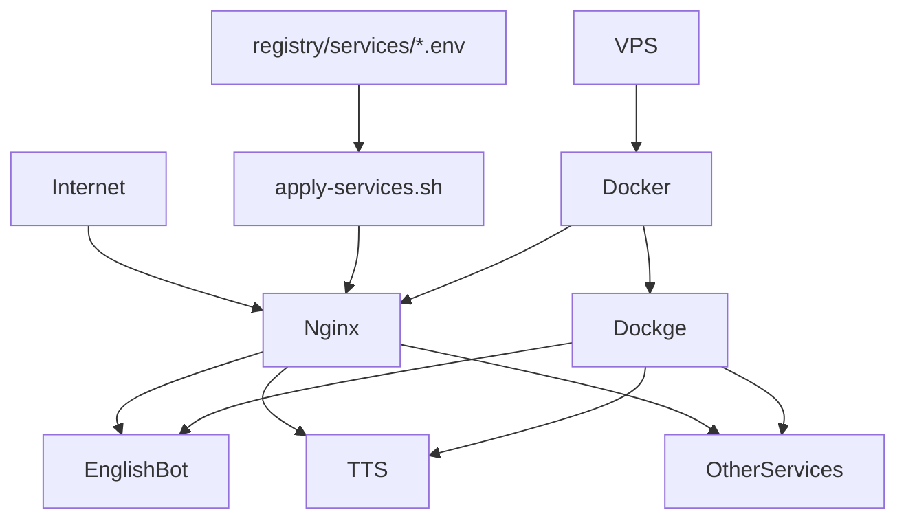

# infra-vps

A small collection of scripts and configuration files that I use to run multiple personal services on a single VPS.

The goal of this project is simple:

> Make a new server take minutes to set up instead of hours.

No Kubernetes.

No Ansible.

No service mesh.

No magic.

Just Docker Compose, Nginx, WireGuard and a handful of scripts that solve problems I kept running into.

---

# What this repository does

This repository manages everything that is shared between services:

* Nginx configuration
* HTTPS certificates (Let's Encrypt)
* service domains
* reverse proxy configuration
* WireGuard
* server bootstrap
* scheduled maintenance tasks

Applications themselves live outside this repository.

Each application has its own Docker Compose stack managed by Dockge.

---

# Typical setup



---

# Why

After running several personal projects I noticed I kept copying the same things between servers:

* nginx configs
* Let's Encrypt setup
* WireGuard
* Docker networks
* deployment scripts
* cron jobs

Eventually I decided to keep all shared infrastructure in one place.

Now moving to another VPS mostly looks like:

```bash
git clone ...
run bootstrap scripts
restore secrets
deploy services
```

instead of manually repeating dozens of small configuration steps.

---

# Repository structure

```text
certbot/
docs/
nginx/
registry/
scripts/
scheduled-tasks/
docker-compose.yml
```

---

# Service model

Every application:

* has its own repository
* has its own Docker Compose stack
* joins the shared Docker network
* is exposed through Nginx

This repository never contains application code.

It only contains the infrastructure shared by every application.

---

# Quick start

Clone the repository.

```bash
git clone <repo> /opt/infra-vps
cd /opt/infra-vps
```

Bootstrap a fresh server.

```bash
sudo bash scripts/001-setup-server.sh
sudo SERVER_PUBLIC_IP=<server-ip> bash scripts/002-setup-wireguard.sh
sudo bash scripts/004-install-scheduled-tasks.sh
sudo bash scripts/005-setup-node-layout.sh
./scripts/006-deploy-infra.sh
sudo bash scripts/007-install-dockge.sh
```

---

# Design goals

* Keep everything understandable.
* Avoid unnecessary abstractions.
* Be able to rebuild a server from scratch.
* Separate infrastructure from applications.
* Keep every service independent.

---

# Documentation

* `docs/overview.md`
* `docs/canonical-node-bootstrap.md`

---

# Current status

This project is actively used to host my own services.

It exists because I wanted a practical solution for my own infrastructure, not because I wanted to build another orchestration platform.
